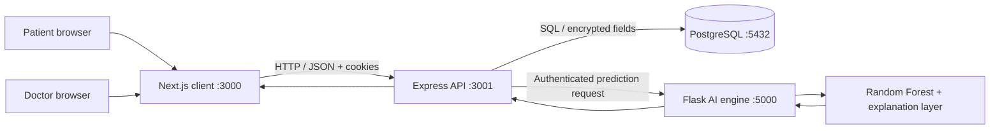

# MediscanAI

## Explainable AI Clinical Decision Support and Disease Detection System

**MediscanAI** is a full-stack healthcare triage prototype that turns patient-reported symptoms into an adaptive assessment, an explainable top-three differential prediction, and a physician-reviewable case. It is designed for academic demonstration, hackathon evaluation, and research—not for autonomous diagnosis or treatment.

> **Safety boundary:** MediscanAI is not a medical device, doctor, emergency service, or substitute for professional medical care. Its model output is decision support only. Anyone with urgent or severe symptoms should contact local emergency services or a qualified healthcare professional immediately.

---

## 1. Submission Snapshot

| Field | Details |
| --- | --- |
| Team | Yash Vijay (Solo) |
| College / Incubator | JECRC Foundation, Jaipur |
| Project title | MediscanAI: Explainable AI Clinical Decision Support and Disease Detection System |
| Category | Healthcare AI, full-stack web application, clinical workflow |
| Current status | Working academic prototype with local Docker, test, deployment, and QA evidence paths |
| Primary value | Explainable triage plus a physician-in-the-loop review loop |

### Why this project is different

Most symptom checkers stop after producing a label. MediscanAI closes the loop:

1. **Adapt:** ask the next relevant question instead of presenting one exhausting checklist.
2. **Explain:** show the top three model candidates and symptom-level contribution information.
3. **Escalate responsibly:** surface safety guidance and clearly communicate uncertainty.
4. **Review:** place the case in a clinician queue for approval, correction, or override.
5. **Account:** persist review status and audit events for traceability.

The central design principle is simple:

> **AI should make the next human decision better informed—not replace the human decision.**

---

## 2. Problem Statement

Patients often do not know whether symptoms require self-monitoring, routine care, prompt clinical review, or urgent attention. Existing digital symptom experiences commonly have three weaknesses:

- long static questionnaires create fatigue and incomplete answers;
- black-box predictions provide little evidence for a patient or clinician to inspect; and
- a prediction is often disconnected from a reviewable healthcare workflow.

MediscanAI addresses these weaknesses with an adaptive questionnaire, a model explanation layer, explicit safety boundaries, and a doctor review portal.

---

## 3. Healthcare Use Case

### Patient journey

1. A patient registers or logs in.
2. The patient starts an authenticated questionnaire.
3. The adaptive flow selects the next relevant question based on current responses.
4. The patient submits the completed symptom assessment.
5. The API requests a prediction from the Flask AI service.
6. The patient receives a preliminary report containing:
   - up to three predicted conditions;
   - confidence scores;
   - human-readable reasoning;
   - symptom contribution information;
   - condition overview and precaution data; and
   - safety and clinical disclaimer language.
7. The case remains available for physician review.

### Clinician journey

1. A doctor or administrator opens the protected submissions queue.
2. The clinician reviews patient-reported symptoms and model evidence.
3. The clinician records `approve`, `correct`, or `override` feedback with notes.
4. The diagnosis status and review event become part of the case history and audit trail.
5. Analytics summarize review and triage activity.

---

## 4. Core Features

- Adaptive symptom questionnaire with decision-tree routing
- Top-three differential prediction
- Random Forest classifier with persisted model artifacts
- Human-readable explanation and severity-weighted feature contributions
- Clinical descriptions and precaution information from bundled datasets
- Deterministic red-flag triage guidance before/alongside AI results
- Patient dashboard, diagnosis history, health report, and dataset viewer
- Doctor dashboard, submissions queue, case history, review workflow, and analytics
- Patient, doctor, and admin role separation
- AES-256-GCM application-layer encryption for selected sensitive fields
- Bcrypt password hashing and HTTP-only JWT cookies
- Request validation with Zod
- Helmet security headers, explicit CORS policy, and API rate limiting
- PostgreSQL schema with indexes, foreign keys, audit records, and protected audit logs
- Responsive desktop and mobile evidence screenshots
- Docker Compose local environment
- Render blueprint and Vercel configuration

---

## 5. AI/ML Model Details

The AI service is a Python Flask microservice using scikit-learn.

| Component | Implementation |
| --- | --- |
| Classifier | `RandomForestClassifier` |
| Estimators | 120 trees |
| Maximum depth | 25 |
| Training split | 85% training / 15% validation, stratified, `random_state=42` |
| Class balancing | `class_weight='balanced'` |
| Training records | 4,920 |
| Symptom features | 132 |
| Disease classes | 41 |
| Additional test set | `test_data.csv`, 42 records in the bundled dataset |
| Model persistence | Joblib |
| Output | Ranked condition candidates and confidence scores |
| Explanation method | Severity-weighted symptom contribution analysis plus clinical knowledge-base text |

### Important explanation accuracy note

The current explainer does **not** claim to calculate SHAP values. It generates human-readable feature contributions from reported symptoms and bundled severity weights, then combines them with condition descriptions and precautions. The project includes SHAP in the Python dependency set for future or extended explainability work, but the current production response should be described as **feature contribution analysis**, not SHAP attribution.

### Model artifacts

The trained artifacts are stored in:

```text
ai-engine/saved_models/
├── classifier.joblib
├── encoder.joblib
├── feature_names.json
├── metrics.json
└── scaler.joblib
```

If artifacts are unavailable, the AI engine can train an initial model from the bundled training data at startup.

### Dataset boundaries

The bundled datasets are open clinical/educational datasets used for a prototype. They do not establish clinical validity, diagnostic safety, demographic fairness, or regulatory approval. Accuracy metrics must be interpreted as dataset-specific engineering measurements, not real-world clinical performance.

---

## 6. Technical Architecture



### Service responsibilities

| Service | Responsibility |
| --- | --- |
| Next.js client | Patient and clinician user experience, authentication state, questionnaire, reports, dashboards |
| Express API | Auth, RBAC, validation, persistence, audit logging, diagnosis orchestration, readiness checks |
| Flask AI engine | Adaptive question support, prediction, dataset metadata, explanation, model retraining endpoint |
| PostgreSQL | Users, questionnaire sessions, diagnoses, feedback, analytics source data, audit logs |

### Request flow

```text
Patient response
  -> authenticated Next.js request
  -> Express validation and role check
  -> PostgreSQL questionnaire record
  -> Flask /predict request
  -> model inference + explanation
  -> diagnosis persistence + audit event
  -> patient report + clinician queue
```

---

## 7. API Surface

### Health

| Method | Endpoint | Purpose |
| --- | --- | --- |
| `GET` | `/api/health` | API liveness check |
| `GET` | `/api/health/ready` | API readiness check including AI engine availability |
| `GET` | `/health` | AI engine health and model-loaded status |

### Authentication

| Method | Endpoint | Access |
| --- | --- | --- |
| `POST` | `/api/auth/register/patient` | Public patient registration |
| `POST` | `/api/auth/login` | Public login |
| `POST` | `/api/auth/refresh` | Refresh session |
| `POST` | `/api/auth/logout` | Authenticated logout |

### Patient questionnaire and diagnosis

| Method | Endpoint | Access |
| --- | --- | --- |
| `POST` | `/api/questionnaire/start` | Patient |
| `POST` | `/api/questionnaire/next` | Patient |
| `GET` | `/api/questionnaire/:sessionId` | Authenticated |
| `POST` | `/api/diagnoses` | Patient |
| `GET` | `/api/diagnoses/latest` | Patient |
| `GET` | `/api/diagnoses/:id` | Authorized patient/doctor |
| `GET` | `/api/diagnoses/datasets/info` | Authenticated |

### Clinician workflow

| Method | Endpoint | Access |
| --- | --- | --- |
| `GET` | `/api/doctors/dashboard` | Doctor/admin |
| `GET` | `/api/doctors/submissions` | Doctor/admin |
| `GET` | `/api/doctors/submissions/:id` | Doctor/admin |
| `GET` | `/api/doctors/case-history/:patientId` | Doctor/admin |
| `GET` | `/api/doctors/analytics` | Doctor/admin |
| `POST` | `/api/feedback` | Doctor/admin |

### AI engine

| Method | Endpoint | Purpose |
| --- | --- | --- |
| `POST` | `/predict` | Return ranked predictions and explanation data |
| `POST` | `/next-question` | Select the next adaptive question |
| `GET` | `/datasets/info` | Return dataset and model metadata |
| `POST` | `/retrain` | Admin-key-protected model retraining |
| `POST` | `/preventive-tips` | Return preventive tips for conditions |

---

## 8. Security and Privacy

### Implemented protections

- Passwords are hashed with bcrypt.
- Access and refresh sessions use JWTs and HTTP-only cookies.
- Sensitive fields such as allergies and chronic conditions are designed for AES-256-GCM encryption.
- Express uses Helmet security headers.
- CORS is restricted to configured origins, with deployment support for Vercel origins.
- API requests are rate-limited by IP.
- Zod schemas validate selected request bodies.
- Role-based middleware separates patient and clinician capabilities.
- Audit middleware records security-sensitive and clinical workflow actions.
- PostgreSQL triggers prevent updates and deletes on audit logs.
- Request IDs are generated or propagated through the API.

### Production security requirements

Before deploying outside a local demo:

1. Replace every development secret with a high-entropy secret.
2. Set a precise `CORS_ORIGIN`; do not use `*` with credentials.
3. Use managed PostgreSQL with encrypted connections and backups.
4. Store secrets in Render/Vercel secret management, not in Git.
5. Use HTTPS everywhere.
6. Do not record real patient data in screenshots or demo videos.
7. Conduct a formal privacy, security, and clinical validation review before any real-world use.

This repository is a prototype and should not be represented as HIPAA-, DPDP-, or regulatory-certified.

---

## 9. Repository Structure

```text
.
├── ai-engine/
│   ├── app.py                 # Flask endpoints
│   ├── config.py              # AI configuration
│   ├── data/                  # Training, test, and clinical knowledge datasets
│   ├── models/                # Classifier, adaptive tree, and explanation logic
│   ├── saved_models/          # Serialized model artifacts and metrics
│   ├── test_logic.py          # AI engine tests
│   └── requirements.txt
├── client/
│   ├── src/app/               # Next.js routes and pages
│   ├── src/components/        # Reusable UI components
│   ├── src/context/           # Auth and API state
│   └── package.json
├── database/
│   ├── schema.sql             # Tables, indexes, triggers
│   └── seed.sql               # Demo records and questionnaire data
├── server/
│   ├── src/config/            # Database, JWT, encryption
│   ├── src/controllers/       # API handlers
│   ├── src/middleware/        # Auth, RBAC, audit, validation
│   ├── src/routes/            # REST routes
│   ├── src/__tests__/         # Jest tests
│   └── package.json
├── qa-evidence/               # Repeatable browser journey and screenshots
├── docker-compose.yml         # Local four-service environment
├── render.yaml                # Render API and AI services
├── vercel.json                # Vercel frontend build
├── projectreport.md           # Extended academic report
├── MediscanAI_Presentation.pptx
└── README.md
```

---

## 10. Local Setup

### Prerequisites

- Node.js 18 or newer
- npm
- Python 3.10 or newer
- Docker Desktop and Docker Compose (recommended), or PostgreSQL 16

### Option A: Docker Compose

From the repository root:

```powershell
docker compose up --build
```

Services:

| Service | Address |
| --- | --- |
| Next.js client | http://localhost:3000 |
| Express API | http://localhost:3001 |
| API liveness | http://localhost:3001/api/health |
| API readiness | http://localhost:3001/api/health/ready |
| Flask AI engine | http://localhost:5000 |
| PostgreSQL | localhost:5432 |

### Option B: Run locally

Create the root environment file:

```powershell
Copy-Item .env.example .env
```

Start the AI engine:

```powershell
Set-Location ai-engine
python -m pip install -r requirements.txt
python app.py
```

Start the API in a second terminal:

```powershell
Set-Location server
npm install
npm run dev
```

Start the frontend in a third terminal:

```powershell
Set-Location client
npm install
npm run dev
```

Open http://localhost:3000.

### Environment variables

Important variables are documented in [`.env.example`](.env.example):

- database: `DB_HOST`, `DB_PORT`, `DB_NAME`, `DB_USER`, `DB_PASSWORD`, `DATABASE_URL`
- authentication: `JWT_ACCESS_SECRET`, `JWT_REFRESH_SECRET`, expiry values
- encryption: `ENCRYPTION_KEY`, `ENCRYPTION_IV_LENGTH`
- services: `AI_ENGINE_URL`, `AI_ENGINE_API_KEY`, `FLASK_PORT`
- frontend/API: `NEXT_PUBLIC_API_URL`, `CORS_ORIGIN`
- rate limiting: `RATE_LIMIT_WINDOW_MS`, `RATE_LIMIT_MAX`

Never commit `.env`, credentials, tokens, or real health data.

---

## 11. Deployment

### Vercel frontend

The root [`vercel.json`](vercel.json) configures a Next.js build from `client/`. Set:

```text
NEXT_PUBLIC_API_URL=https://<your-api-service>/api
```

### Render backend and AI engine

[`render.yaml`](render.yaml) defines:

- `althea-api`: Node/Express service rooted at `server`
- `althea-ai-engine`: Python/Gunicorn service rooted at `ai-engine`

After deployment, set `AI_ENGINE_URL` on the API service to the public AI engine URL and set `CORS_ORIGIN` to the deployed frontend origin. The API health check is `/api/health`; the AI health check is `/health`.

### Production deployment checklist

- [ ] Deploy frontend and API over HTTPS.
- [ ] Configure exact frontend/API origins.
- [ ] Configure generated JWT, encryption, and AI service secrets.
- [ ] Attach production PostgreSQL; do not rely on a development fallback.
- [ ] Confirm `/api/health/ready` returns `200`.
- [ ] Create a synthetic demo account.
- [ ] Verify patient and doctor role boundaries.
- [ ] Remove all real or sensitive data from screenshots and recordings.

---

## 12. Verification and Evidence

### Automated checks

Run the smallest relevant checks:

```powershell
# Backend
Set-Location server
npm test

# AI engine
Set-Location ..\ai-engine
python test_logic.py

# Frontend production build
Set-Location ..\client
npm run build
```

### Browser evidence

The [`qa-evidence/`](qa-evidence/) folder contains:

- repeatable browser journey instructions;
- landing, registration, login, questionnaire, diagnosis, and health-report screenshots;
- desktop and mobile responsive evidence;
- doctor overview, submissions, and analytics screenshots; and
- a privacy-safe video storyboard using synthetic data.

The QA evidence is designed for reproducible demos. Do not capture passwords, tokens, cookies, developer tools, database snapshots, or real patient information.

### Verification matrix

| Area | Evidence in repository |
| --- | --- |
| Patient flow | `qa-evidence/screenshots/questionnaire-desktop.png`, `health-report-desktop.png` |
| Clinician flow | `doctor-overview-desktop.png`, `doctor-submissions-desktop.png` |
| Analytics | `doctor-analytics-desktop.png` |
| Responsive design | `datasets-mobile.png`, `doctor-submissions-mobile.png` |
| Backend behavior | `server/src/__tests__/` |
| AI behavior | `ai-engine/test_logic.py` |
| Architecture | `docker-compose.yml`, `render.yaml`, `vercel.json` |
| Presentation | [`MediscanAI_Presentation.pptx`](MediscanAI_Presentation.pptx) |

---

## 13. Demo Script for Judges

Use synthetic data and keep the demo focused:

1. Start at the landing page and state the safety boundary.
2. Register a synthetic patient.
3. Complete the adaptive questionnaire.
4. Show the top-three result, confidence, explanation, and precautions.
5. Open the health report and explain the patient-facing summary.
6. Sign out and show protected-route behavior.
7. Log in as a seeded/demo clinician.
8. Open the patient submissions queue.
9. Review the same case and demonstrate approve/correct/override.
10. Open analytics and show the workflow's accountability layer.

For the full recording plan, see [`qa-evidence/video-storyboard.md`](qa-evidence/video-storyboard.md).

---

## 14. Known Limitations and Honest Next Steps

MediscanAI is intentionally presented as a responsible prototype:

- the training data is limited and may not represent all populations;
- model confidence is not clinical probability or certainty;
- the explainer uses severity-weighted contributions, not validated clinical causal reasoning;
- no real-world clinical trial or prospective validation is claimed;
- the development fallback database is not a production persistence strategy;
- no external demo video, architecture PDF, or presentation URL is currently embedded in this repository;
- multilingual support, referral integration, and probability calibration are future work; and
- regulatory, privacy, and clinical review are required before real-world deployment.

### Roadmap

1. Calibrate and externally validate model probabilities.
2. Measure clinician agreement, review time, false-negative risk, and subgroup performance.
3. Add multilingual, accessibility-first, and low-bandwidth experiences.
4. Add secure referral and follow-up workflows.
5. Add clinician-approved retraining governance with dataset versioning.

Being explicit about these boundaries makes the project more credible: the product is ambitious, but its claims remain evidence-based.

---

## 15. Submission Materials

| Requirement | Status |
| --- | --- |
| README with project, team, use case, stack, and AI details | Complete |
| Architecture diagram | Included in this README; editable system configuration in repository |
| Project presentation | [`MediscanAI_Presentation.pptx`](MediscanAI_Presentation.pptx) |
| 15–20 minute unlisted YouTube demo | Add final public URL before submission |
| Public architecture PDF/PPT | Add final public URL before submission |
| All links accessible without extra permission | Verify after uploading external materials |

Before submitting, replace each external-link placeholder with a working public URL and test it in an incognito browser window.

---

## License

No root `LICENSE` file is currently present in this repository. Choose and add an approved open-source license before claiming that the project is open source or publishing a license badge.

---

## Project Status

MediscanAI is an academic prototype with a working full-stack architecture, model service, clinician workflow, automated test paths, deployment configuration, and browser evidence. It is not certified for clinical use and must not be used as a substitute for professional medical evaluation.
