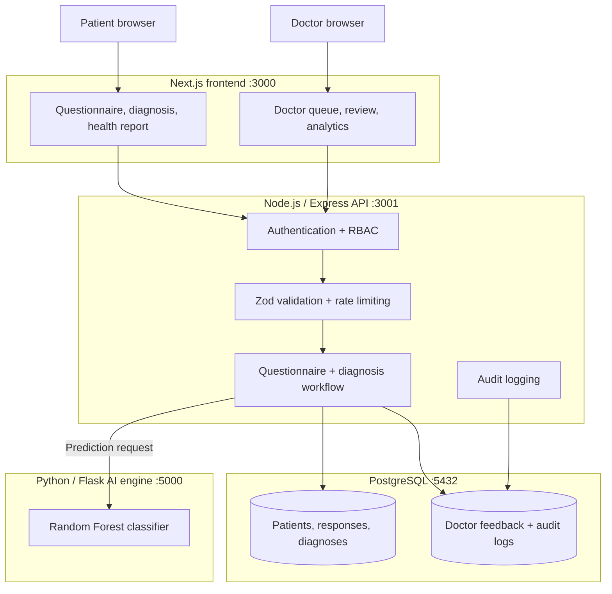

# MediscanAI

## Guided symptom intake research prototype

MediscanAI is an early-stage research prototype for guided symptom intake and experimental model estimates. It has not been clinically validated.

It combines:

- a branching symptom questionnaire;
- a machine-learning model that may return up to three estimates when its minimum evidence gate is met;
- deterministic questionnaire red-flag rules;
- and a clinician account workflow to approve, correct, or override a submitted result.

The model estimate is not a diagnosis. Model-backed symptom explanations and cited condition-specific care guidance are currently unavailable.

> **Medical disclaimer:** MediscanAI is an academic prototype for triage assistance and demonstration. It is not a diagnosis, treatment service, emergency service, or replacement for a qualified healthcare professional. It has not been clinically or regulatorily certified.

---

## Project Details

| | |
|---|---|
| **Team** | Yash Vijay — Solo |
| **College / Incubator** | JECRC Foundation, Jaipur |
| **Project** | MediscanAI: Symptom Intake Research Prototype |
| **Focus** | Symptom intake, experimental classification, and clinician review workflow |

---

## The problem

Most online symptom tools have one of two problems:

1. They ask a long, fixed list of questions, so users lose patience or miss important details.
2. They return a result without showing how it was reached or giving a clinician a structured way to review it.

Healthcare is a high-stakes setting. A model should not simply output a disease name and stop. It should communicate uncertainty, show supporting evidence, identify safety concerns, and leave the final decision with a healthcare professional.

---

## My solution

MediscanAI currently provides a four-step workflow:

### 1. Ask

The questionnaire follows a fixed branching path based on the patient's answers. It does not select questions using expected information gain.

### 2. Estimate

The AI engine may return up to three model estimates. It abstains when fewer than two symptoms are detected. The percentages are experimental model estimates, not clinical probabilities.

### 3. Protect

The system provides a disclaimer and deterministic red-flag guidance. The red-flag rules have not been clinically validated.

### 4. Review

The case moves into a role-protected clinician portal. A clinician account can review the symptoms and approve, correct, or override the result. Account holders' qualifications are not independently verified by this prototype.

This prototype combines a branching intake, model estimate, and case review workflow.

---

## Architecture

The complete application is split into four clear layers:



### What happens during a diagnosis

```text
Patient answers questions
        ↓
Next.js sends the authenticated assessment to the Express API
        ↓
The API validates the request and stores the questionnaire session
        ↓
The Flask service converts responses into a 132-feature symptom vector
        ↓
Random Forest ranks the possible conditions
        ↓
The model returns estimates or abstains when too little evidence is present. Model-backed feature explanations are currently unavailable.
        ↓
The API stores the result and creates a reviewable doctor submission
        ↓
Patient sees a preliminary report; doctor can approve, correct, or override it
```

### Why this architecture is practical

- The frontend, API, database, and AI engine can be developed and deployed independently.
- The API is the control point for authentication, validation, persistence, and audit events.
- The AI engine can be improved without rewriting the patient or doctor interfaces.
- The doctor review layer prevents the model from becoming the final authority.
- Docker Compose provides a reproducible local environment.
- Render and Vercel configuration is included for deployment.

---

## AI/ML implementation

The AI service is a Python Flask microservice using scikit-learn.

| Item | Implementation |
|---|---|
| Classifier | `RandomForestClassifier` |
| Trees | 80 |
| Maximum depth | 20 |
| Training rows | 4,920 |
| Unique training profiles | 304 |
| Symptom features | Read from the loaded model artifact |
| Disease classes | Read from the loaded model artifact |
| Clinical validation | None |
| Model storage | Joblib artifacts |
| Output | Ranked top-three conditions and confidence scores |

The model artifacts are stored in [`ai-engine/saved_models/`](ai-engine/saved_models/):

```text
classifier.joblib
encoder.joblib
feature_names.json
metrics.json
scaler.joblib
```

### Model explanations

Model-backed feature attributions are currently disabled. The application does not claim SHAP explanations or display hand-authored symptom weights as model reasoning.

### Dataset limitations

The training corpus contains synthetic symptom profiles, not patient diagnostic records. Duplicate profiles make naive performance measures unreliable. The model has not been clinically validated; its estimates do not establish clinical validity, fairness, or regulatory approval.

---

## Product workflow

### Patient side

- Register and sign in securely
- Start a guided branching assessment
- Answer focused symptom questions
- View any returned model estimates
- See the model estimate, if returned, or an explicit no-estimate state
- View diagnosis history and health reports

### Doctor side

- Open the protected submissions queue
- Filter and inspect patient cases
- Review symptoms and the model estimate, if present
- Approve, correct, or override the result
- Add clinical notes
- View review and triage analytics

### Safety and privacy

- Passwords are hashed with bcrypt.
- JWT sessions use HTTP-only cookies.
- Allergies and chronic conditions are encrypted with AES-256-GCM before storage; other records are not field-encrypted.
- Role-based access separates patient and doctor capabilities.
- Zod validates selected API inputs.
- Helmet, CORS restrictions, and rate limiting protect the API surface.
- Audit middleware records important authentication and clinical workflow actions.
- Database triggers protect audit logs from update and delete operations.

This is a prototype. Production use would require clinical validation, privacy review, threat modelling, managed infrastructure, monitoring, and regulatory assessment.

---

## Technology stack

| Layer | Technologies |
|---|---|
| Frontend | Next.js 16, React 19, App Router |
| Backend | Node.js, Express, Axios, Zod |
| AI engine | Python, Flask, scikit-learn, pandas, NumPy, Joblib |
| Database | PostgreSQL 17 |
| Security | bcryptjs, JWT, AES-256-GCM, Helmet, CORS, rate limiting |
| Testing | Jest and Python `unittest` |
| Deployment | Docker Compose, Render, Vercel, Gunicorn |

---

## Repository layout

```text
.
├── ai-engine/                 # Flask API, datasets, model, explanation logic
├── client/                    # Next.js patient and doctor interface
├── database/                  # PostgreSQL schema and seed data
├── server/                    # Express API, auth, RBAC, and tests
├── qa-evidence/               # Browser journeys and screenshots
├── docker-compose.yml         # Local multi-service setup
├── render.yaml                # Render backend and AI services
├── vercel.json                # Vercel frontend configuration
├── projectreport.md           # Extended academic report
├── MediscanAI_Presentation.pptx
└── README.md
```

---

## Run locally

### Requirements

- Node.js 18+
- npm
- Python 3.10+
- PostgreSQL 17, or Docker Desktop

### Recommended: Docker Compose

From the repository root:

```powershell
docker compose up --build
```

Open:

| Service | Address |
|---|---|
| Frontend | http://localhost:3000 |
| API | http://localhost:3001 |
| API health | http://localhost:3001/api/health |
| API readiness | http://localhost:3001/api/health/ready |
| AI engine | http://localhost:5000 |
| PostgreSQL | localhost:5432 |

### Run services separately

Create local configuration:

```powershell
Copy-Item .env.example .env
```

Start the AI engine:

```powershell
Set-Location ai-engine
python -m pip install -r requirements.txt
python app.py
```

Start the API in another terminal:

```powershell
Set-Location server
npm install
npm run dev
```

Start the frontend in another terminal:

```powershell
Set-Location client
npm install
npm run dev
```

Then open http://localhost:3000.

Never commit `.env`, credentials, tokens, or real patient information.

---

## Verification

The project was verified with:

```powershell
# Backend tests: 9 tests passed
Set-Location server
npm test -- --runInBand

# AI engine tests: 3 tests passed
Set-Location ..\ai-engine
python test_logic.py

# Frontend production build
Set-Location ..\client
npm run build
```

The repository also includes browser evidence for:

- landing page, registration, and login;
- guided branching questionnaire;
- diagnosis and health report;
- doctor overview and submissions;
- doctor analytics; and
- mobile responsive layouts.


## What I would build next

The current prototype establishes the workflow. The next engineering priorities are:

1. externally validate and calibrate model probabilities;
2. measure clinician agreement, review time, false-negative risk, and subgroup performance;
3. add multilingual and accessibility-first experiences;
4. add secure referral and follow-up workflows; and
5. introduce versioned, clinician-approved retraining with dataset governance.

.

---

## Submission files

- [Project presentation](MediscanAI_Presentation.pptx)
- [Extended project report](projectreport.md)
- [QA evidence](qa-evidence/README.md)


---

## License


---

## Final statement

MediscanAI is a research prototype for symptom intake and experimental model estimates. It has not been clinically validated, and model-backed feature explanations are currently unavailable.
