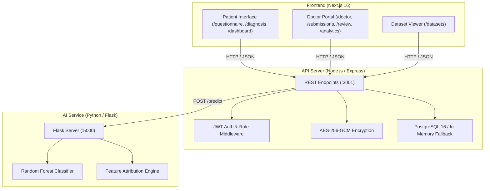

# Althea AI

Clinical decision support system and diagnostic triage platform built with Next.js, Express, and a Python Random Forest classification service.

---

## Medical Disclaimer

Althea AI is an experimental decision-support tool designed for preliminary triage, research, and technical demonstration. It does not provide medical diagnoses, clinical treatment plans, or emergency services. Consult a qualified healthcare professional for medical concerns. In an emergency, contact local emergency services immediately.

---

## Overview

Althea AI connects symptom intake questionnaires to a machine learning classifier and a doctor review workflow:

1. **Questionnaire**: An adaptive questionnaire guides patients through symptom assessment based on decision-tree routing.
2. **Classification**: Patient responses are evaluated by a Random Forest model trained on a standard clinical dataset (4,920 records across 132 symptoms and 41 disease classes).
3. **Differential Diagnosis & Feature Attribution**: The model returns the top 3 candidate conditions with confidence scores and symptom contribution weights.
4. **Physician Review**: Submissions enter a doctor review queue where clinical staff can review predictions, record notes, and approve or override classifications.
5. **Security**: Field-level AES-256-GCM encryption for patient data, JWT authentication with role-based access control (`patient`, `doctor`, `admin`), and append-only database audit logs.

---

## Architecture



---

## Tech Stack

- **Frontend**: Next.js 16 (App Router), React 19, CSS modules / vanilla CSS
- **Backend**: Node.js, Express 4.18, Zod (schema validation), Helmet, CORS, express-rate-limit
- **Machine Learning**: Python 3.10+, Flask, scikit-learn (RandomForestClassifier), pandas, numpy, joblib
- **Database**: PostgreSQL 16 (pg driver) with in-memory fallback for local development
- **Security**: AES-256-GCM encryption at rest, bcryptjs password hashing, HTTP-only JWT cookies
- **Containerization**: Docker, Docker Compose

---

## Directory Structure

```text
.
├── client/                     # Next.js frontend
│   ├── src/
│   │   ├── app/
│   │   │   ├── (dashboard)/    # Authenticated patient and doctor routes
│   │   │   │   ├── dashboard/      # Patient dashboard and past records
│   │   │   │   ├── questionnaire/  # Multi-step symptom questionnaire
│   │   │   │   ├── diagnosis/      # Differential diagnosis and score breakdown
│   │   │   │   ├── health-report/  # Patient health summary
│   │   │   │   ├── datasets/       # Training dataset viewer
│   │   │   │   └── doctor/         # Clinician queue, review, and analytics
│   │   │   ├── login/          # Login page
│   │   │   ├── register/       # Patient registration
│   │   │   ├── globals.css     # Global styles and theme tokens
│   │   │   └── page.js         # Landing page
│   │   ├── components/         # Reusable UI elements and icons
│   │   └── context/            # Authentication context and HTTP helpers
│   └── package.json
│
├── server/                     # Express REST API
│   ├── src/
│   │   ├── config/             # Database connection, crypto, JWT config
│   │   ├── controllers/        # Request handlers for auth, diagnosis, etc.
│   │   ├── middleware/         # Auth verification, role checks, validation
│   │   ├── routes/             # API route definitions
│   │   ├── utils/              # Error handling and helper functions
│   │   ├── __tests__/          # Jest test suite
│   │   └── index.js            # Server entry point
│   └── package.json
│
├── ai-engine/                  # Python Flask classification service
│   ├── data/                   # Clinical datasets (CSV format)
│   │   ├── training_data.csv       # 4,920 records, 132 symptom columns
│   │   ├── test_data.csv           # 42 validation test cases
│   │   ├── symptom_Description.csv # Condition summaries
│   │   ├── symptom_precaution.csv  # Care precautions per condition
│   │   └── symptom_severity.csv    # Symptom severity weights
│   ├── saved_models/           # Serialized model artifacts (.joblib)
│   ├── models/                 # Classifier, decision tree, and explainer logic
│   ├── app.py                  # Flask application entry point
│   ├── test_logic.py           # Unit tests
│   └── requirements.txt
│
├── database/
│   ├── schema.sql              # Table definitions and audit triggers
│   └── seed.sql                # Seed accounts and questionnaire nodes
│
├── docker-compose.yml          # Container configuration
├── .env.example                # Sample environment variables
└── README.md
```

---

## Getting Started

### Prerequisites

- Node.js 18+ and npm
- Python 3.10+
- (Optional) Docker and Docker Compose
- (Optional) PostgreSQL 16 (an in-memory store is used if PostgreSQL is not running)

---

### Local Setup

#### 1. Environment Variables

Copy `.env.example` to `.env`:

```bash
cp .env.example .env
```

*(On Windows PowerShell: `Copy-Item .env.example .env`)*

The default configuration points to local ports (`3000` client, `3001` server, `5000` AI engine) and contains development secrets.

#### 2. Start the AI Engine

```bash
cd ai-engine
pip install -r requirements.txt
python app.py
```

The service runs on `http://localhost:5000`.

#### 3. Start the Backend API

In a new terminal:

```bash
cd server
npm install
npm run dev
```

The server runs on `http://localhost:3001`. If a PostgreSQL instance is not detected on port 5432, it will automatically fall back to its internal in-memory store.

#### 4. Start the Frontend

In a new terminal:

```bash
cd client
npm install
npm run dev
```

Open [http://localhost:3000](http://localhost:3000) in your browser.

---

### Docker Setup

To run all services in containers:

```bash
docker-compose up --build -d
```

Services:
- Client: `http://localhost:3000`
- API Server: `http://localhost:3001`
- AI Engine: `http://localhost:5000`
- PostgreSQL: `localhost:5432`

---

### Cloud Deployment

#### Vercel (Frontend)

1. Import the repository into [Vercel](https://vercel.com).
2. Set the **Root Directory** to `client` (or let Vercel use the root `vercel.json`).
3. Add the environment variable:
   - `NEXT_PUBLIC_API_URL`: `https://<your-backend-service>.onrender.com/api`
4. Deploy.

#### Render (Backend & AI Microservice)

The repository includes a `render.yaml` Blueprint specification for deploying both services:

**Option 1: Blueprint Deployment (Recommended)**
1. Go to the [Render Dashboard](https://dashboard.render.com) and click **New** > **Blueprint**.
2. Connect your repository. Render will detect `render.yaml` and configure both services:
   - `althea-api`: Node.js Express service (`server`)
   - `althea-ai-engine`: Python Flask/Gunicorn service (`ai-engine`)
3. Set `AI_ENGINE_URL` on the API service to your AI Engine Render URL.

**Option 2: Manual Web Services**
1. **AI Engine**:
   - Runtime: Python 3
   - Root Directory: `ai-engine`
   - Build Command: `pip install -r requirements.txt`
   - Start Command: `gunicorn --bind 0.0.0.0:$PORT app:app`
2. **Backend API**:
   - Runtime: Node
   - Root Directory: `server`
   - Build Command: `npm install`
   - Start Command: `npm start`
   - Environment Variables:
     - `NODE_ENV`: `production`
     - `AI_ENGINE_URL`: `https://<ai-service>.onrender.com`
     - `CORS_ORIGIN`: `https://<your-vercel-domain>.vercel.app`
     - `JWT_ACCESS_SECRET`: `<random-secret>`
     - `JWT_REFRESH_SECRET`: `<random-secret>`
     - `ENCRYPTION_KEY`: `<64-hex-characters>`

---

## Seed Accounts

The following test accounts are pre-configured:

| Role | Email | Password | Scope |
| :--- | :--- | :--- | :--- |
| Doctor | `sarah.mitchell@hospital.com` | `Doctor@123` | Patient queue, review workflow, analytics |
| Doctor | `james.rodriguez@hospital.com` | `Doctor@123` | Patient queue, review workflow |
| Admin | `admin@hospital.com` | `Doctor@123` | System oversight and analytics |
| Patient | Self-register at `/register` | User-defined | Questionnaire, diagnosis results, patient dashboard |

---

## Running Tests

### Backend Tests (Jest)

Tests covering encryption, JWT token management, user data sanitization, and Zod input validation schemas:

```bash
cd server
npm test
```

### AI Engine Tests (Python)

Tests covering dataset loading, model predictions, and feature attribution:

```bash
cd ai-engine
python test_logic.py
```

### Client Build Verification

```bash
cd client
npm run build
```

---

## API Reference

### Authentication (`/api/auth`)

| Method | Endpoint | Access | Description |
| :--- | :--- | :--- | :--- |
| `POST` | `/api/auth/register/patient` | Public | Register new patient account |
| `POST` | `/api/auth/login` | Public | Authenticate user, set auth cookie, return JWT |
| `POST` | `/api/auth/refresh` | Public | Refresh access token |
| `POST` | `/api/auth/logout` | Authenticated | Clear session cookie |

### Questionnaire (`/api/questionnaire`)

| Method | Endpoint | Access | Description |
| :--- | :--- | :--- | :--- |
| `POST` | `/api/questionnaire/start` | Patient | Start new session, returns root question node |
| `POST` | `/api/questionnaire/next` | Patient | Submit answer, returns next question or completion status |

### Diagnosis (`/api/diagnoses`)

| Method | Endpoint | Access | Description |
| :--- | :--- | :--- | :--- |
| `POST` | `/api/diagnoses` | Patient | Request diagnosis based on questionnaire responses |
| `GET` | `/api/diagnoses/:id` | Patient/Doctor | Get specific diagnosis and feature attribution data |
| `GET` | `/api/diagnoses/latest` | Patient | Get most recent diagnosis for the current user |
| `GET` | `/api/diagnoses/datasets/info` | Authenticated | Get dataset summary and class distribution |

### Doctor Portal (`/api/doctors`, `/api/feedback`)

| Method | Endpoint | Access | Description |
| :--- | :--- | :--- | :--- |
| `GET` | `/api/doctors/dashboard` | Doctor | Dashboard metrics (pending cases, reviewed counts) |
| `GET` | `/api/doctors/submissions` | Doctor | List patient submissions (filterable by status) |
| `GET` | `/api/doctors/submissions/:id` | Doctor | Submission details with symptom data |
| `POST` | `/api/feedback` | Doctor | Submit review action (`approve`, `override`, `correct`) |
| `GET` | `/api/doctors/analytics` | Doctor/Admin | Aggregate triage and classification statistics |

---

## Security Implementation

- **Data Encryption**: Patient PII and sensitive health fields are encrypted using AES-256-GCM before storage.
- **Authentication**: Stateless access and refresh tokens via JSON Web Tokens (JWT), with passwords hashed using bcrypt (12 salt rounds).
- **Audit Logging**: PostgreSQL trigger logs insert, update, and review events to an append-only audit table.
- **Network & Headers**: Helmet security middleware, rate limiting (100 requests per 15 minutes per IP), and explicit CORS origin whitelisting.

---

## License

This project is licensed under the [MIT License](LICENSE).
