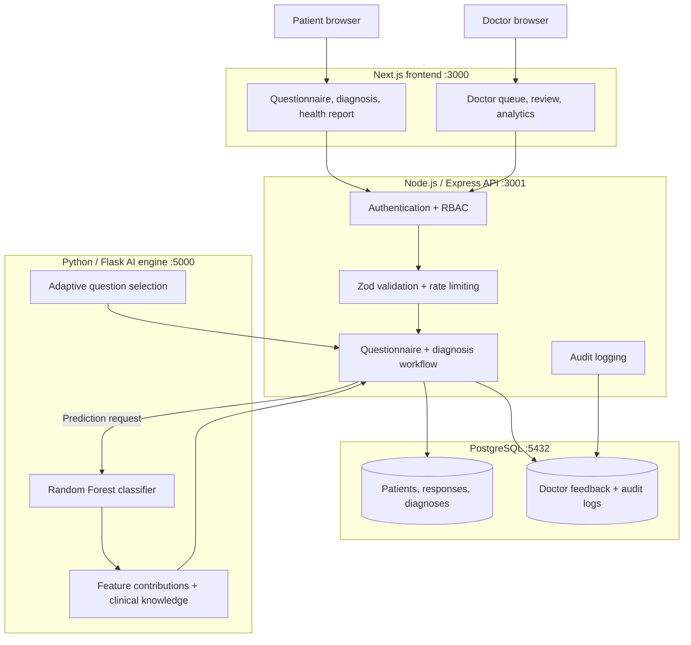

# MediscanAI

## Explainable AI for safer first healthcare decisions

MediscanAI is a clinical decision-support prototype that helps a patient move from **“What could these symptoms mean?”** to **“What should I do next?”**

It combines:

- an adaptive symptom questionnaire;
- a machine-learning model that returns a top-three differential;
- human-readable reasoning and symptom contributions;
- clear safety guidance;
- and a doctor review workflow where an AI result can be approved, corrected, or overridden.

The important part is not just the prediction. The important part is what happens around the prediction: the patient sees context, the clinician sees the case, and the system records the review.

> **Medical disclaimer:** MediscanAI is an academic prototype for triage assistance and demonstration. It is not a diagnosis, treatment service, emergency service, or replacement for a qualified healthcare professional. It has not been clinically or regulatorily certified.

---

## Project Details

| | |
|---|---|
| **Team** | Yash Vijay — Solo |
| **College / Incubator** | JECRC Foundation, Jaipur |
| **Project** | MediscanAI: Explainable AI Clinical Decision Support and Disease Detection System |
| **Focus** | Healthcare AI, explainability, privacy, and physician-in-the-loop design |

---

## The problem

Most online symptom tools have one of two problems:

1. They ask a long, fixed list of questions, so users lose patience or miss important details.
2. They return a result without showing how it was reached or giving a clinician a structured way to review it.

Healthcare is a high-stakes setting. A model should not simply output a disease name and stop. It should communicate uncertainty, show supporting evidence, identify safety concerns, and leave the final decision with a healthcare professional.

---

## My solution

MediscanAI is built around a simple four-step loop:

### 1. Adapt

The questionnaire chooses relevant follow-up questions from the patient's previous answers instead of showing every question at once.

### 2. Explain

The AI engine returns up to three likely conditions, confidence scores, a clinical overview, precautions, and symptom-level feature contributions.

### 3. Protect

The system provides explicit clinical disclaimers and deterministic red-flag guidance. It does not present the output as certainty or treatment advice.

### 4. Review

The case moves into a protected doctor portal. A doctor can review the symptoms and model reasoning, then approve, correct, or override the result. That decision is recorded for traceability.

This makes MediscanAI a workflow, not just a machine-learning demo.

---

## Architecture

The complete application is split into four clear layers:



### What happens during a diagnosis

```text
Patient answers questions
        ↓
Next.js sends the authenticated assessment to the Express API
        ↓
The API validates the request and stores the questionnaire session
        ↓
The Flask service converts responses into a 132-feature symptom vector
        ↓
Random Forest ranks the possible conditions
        ↓
The explanation layer adds symptom contributions, descriptions, and precautions
        ↓
The API stores the result and creates a reviewable doctor submission
        ↓
Patient sees a preliminary report; doctor can approve, correct, or override it
```

### Why this architecture is practical

- The frontend, API, database, and AI engine can be developed and deployed independently.
- The API is the control point for authentication, validation, persistence, and audit events.
- The AI engine can be improved without rewriting the patient or doctor interfaces.
- The doctor review layer prevents the model from becoming the final authority.
- Docker Compose provides a reproducible local environment.
- Render and Vercel configuration is included for deployment.

---

## AI/ML implementation

The AI service is a Python Flask microservice using scikit-learn.

| Item | Implementation |
|---|---|
| Classifier | `RandomForestClassifier` |
| Trees | 120 |
| Maximum depth | 25 |
| Training records | 4,920 |
| Symptom features | 132 |
| Disease classes | 41 |
| Validation | Stratified 85/15 split with `random_state=42` |
| Additional test data | 42 bundled test cases |
| Model storage | Joblib artifacts |
| Output | Ranked top-three conditions and confidence scores |

The model artifacts are stored in [`ai-engine/saved_models/`](ai-engine/saved_models/):

```text
classifier.joblib
encoder.joblib
feature_names.json
metrics.json
scaler.joblib
```

### Explainability, accurately described

The current system uses **severity-weighted symptom feature contributions** and a clinical knowledge base to generate its explanation. It does not claim that the current response is a validated SHAP explanation. SHAP is present in the Python dependencies for future or extended explainability work, but the implemented output should be understood as feature contribution analysis.

This distinction matters. The project communicates what is implemented instead of overstating the model.

### Dataset limitations

The bundled datasets are open clinical and educational datasets used for a prototype. Their accuracy does not establish clinical validity, fairness across populations, or regulatory approval. Confidence scores are model scores, not clinical certainty.

---

## Product workflow

### Patient side

- Register and sign in securely
- Start an adaptive assessment
- Answer focused symptom questions
- View the preliminary top-three result
- Read the explanation, condition overview, and precautions
- View diagnosis history and health reports

### Doctor side

- Open the protected submissions queue
- Filter and inspect patient cases
- Review symptoms and model evidence
- Approve, correct, or override the result
- Add clinical notes
- View review and triage analytics

### Safety and privacy

- Passwords are hashed with bcrypt.
- JWT sessions use HTTP-only cookies.
- Selected sensitive fields are encrypted with AES-256-GCM before storage.
- Role-based access separates patient and doctor capabilities.
- Zod validates selected API inputs.
- Helmet, CORS restrictions, and rate limiting protect the API surface.
- Audit middleware records important authentication and clinical workflow actions.
- Database triggers protect audit logs from update and delete operations.

This is a prototype. Production use would require clinical validation, privacy review, threat modelling, managed infrastructure, monitoring, and regulatory assessment.

---

## Technology stack

| Layer | Technologies |
|---|---|
| Frontend | Next.js 16, React 19, App Router |
| Backend | Node.js, Express, Axios, Zod |
| AI engine | Python, Flask, scikit-learn, pandas, NumPy, Joblib |
| Database | PostgreSQL 16 |
| Security | bcryptjs, JWT, AES-256-GCM, Helmet, CORS, rate limiting |
| Testing | Jest and Python `unittest` |
| Deployment | Docker Compose, Render, Vercel, Gunicorn |

---

## Repository layout

```text
.
├── ai-engine/                 # Flask API, datasets, model, explanation logic
├── client/                    # Next.js patient and doctor interface
├── database/                  # PostgreSQL schema and seed data
├── server/                    # Express API, auth, RBAC, and tests
├── qa-evidence/               # Browser journeys and screenshots
├── docker-compose.yml         # Local multi-service setup
├── render.yaml                # Render backend and AI services
├── vercel.json                # Vercel frontend configuration
├── projectreport.md           # Extended academic report
├── MediscanAI_Presentation.pptx
└── README.md
```

---

## Run locally

### Requirements

- Node.js 18+
- npm
- Python 3.10+
- PostgreSQL 16, or Docker Desktop

### Recommended: Docker Compose

From the repository root:

```powershell
docker compose up --build
```

Open:

| Service | Address |
|---|---|
| Frontend | http://localhost:3000 |
| API | http://localhost:3001 |
| API health | http://localhost:3001/api/health |
| API readiness | http://localhost:3001/api/health/ready |
| AI engine | http://localhost:5000 |
| PostgreSQL | localhost:5432 |

### Run services separately

Create local configuration:

```powershell
Copy-Item .env.example .env
```

Start the AI engine:

```powershell
Set-Location ai-engine
python -m pip install -r requirements.txt
python app.py
```

Start the API in another terminal:

```powershell
Set-Location server
npm install
npm run dev
```

Start the frontend in another terminal:

```powershell
Set-Location client
npm install
npm run dev
```

Then open http://localhost:3000.

Never commit `.env`, credentials, tokens, or real patient information.

---

## Verification

The project was verified with:

```powershell
# Backend tests: 9 tests passed
Set-Location server
npm test -- --runInBand

# AI engine tests: 3 tests passed
Set-Location ..\ai-engine
python test_logic.py

# Frontend production build
Set-Location ..\client
npm run build
```

The repository also includes browser evidence for:

- landing page, registration, and login;
- adaptive questionnaire;
- diagnosis and health report;
- doctor overview and submissions;
- doctor analytics; and
- mobile responsive layouts.


## What I would build next

The current prototype establishes the workflow. The next engineering priorities are:

1. externally validate and calibrate model probabilities;
2. measure clinician agreement, review time, false-negative risk, and subgroup performance;
3. add multilingual and accessibility-first experiences;
4. add secure referral and follow-up workflows; and
5. introduce versioned, clinician-approved retraining with dataset governance.

.

---

## Submission files

- [Project presentation](MediscanAI_Presentation.pptx)
- [Extended project report](projectreport.md)
- [QA evidence](qa-evidence/README.md)


---

## License


---

## Final statement

MediscanAI is built around a responsible idea: in healthcare, a useful AI system should be **adaptive enough to reduce friction, explainable enough to be questioned, and connected to a human workflow before action is taken**.
