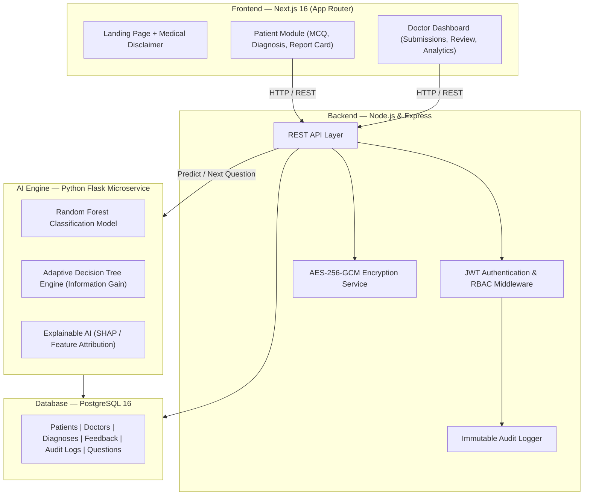

<div align="center">
  

  <h1>Althea AI</h1>
  <h3>The Next-Generation Medical Diagnostic Intelligence Platform</h3>

  <p>
    <strong>A production-grade, highly secure, and explainable AI diagnostic system.</strong><br/>
    Bridging the gap between patient symptoms and precise clinical triage through an adaptive decision-tree engine, Explainable AI (XAI), and continuous physician oversight.
  </p>

  <p>
    <a href="https://github.com/yash23082007/Althea-AI/issues"></a>
    <a href="https://github.com/yash23082007/Althea-AI/network/members"></a>
    <a href="https://github.com/yash23082007/Althea-AI/stargazers"></a>
    <a href="https://github.com/yash23082007/Althea-AI/blob/main/LICENSE"></a>
  </p>
</div>

---

## ⚠️ Important Medical Disclaimer

**Althea AI is designed for informational, educational, and preliminary triage purposes only. It does not constitute professional medical advice, diagnosis, or treatment.**
- Always seek the advice of a physician or other qualified health provider with any questions you may have regarding a medical condition.
- Never disregard professional medical advice or delay seeking it because of something you have read or received from this application.
- If you think you may have a medical emergency, call your local emergency services immediately.

---

## 🌟 Vision & Overview

**Althea AI** was built to solve the black-box problem in medical AI. While generic symptom checkers present endless checklists, Althea AI adapts to the patient's specific presentation through dynamic decision trees, analyzes the data using a Random Forest model, and most importantly—**explains its reasoning** using feature attribution (XAI). 

Every prediction is presented alongside a clear explanation of *why* the AI arrived at that conclusion, and is subsequently routed to a licensed physician for review, creating a continuous feedback loop that prevents over-diagnosis and ensures clinical sanity.

---

## 🚀 Key Features

### 1. Explainable AI (XAI) Engine
- **No Black Boxes**: Utilizes a SHAP-inspired explainer module to quantify the exact weight of each symptom contributing to a diagnosis.
- **Adaptive Questionnaire**: A Bayesian decision-tree approach that dynamically alters the line of questioning based on prior answers, reducing consultation time to 3-4 minutes.
- **Top-N Differential Diagnoses**: Returns the top 3 most likely conditions along with confidence intervals.

### 2. Clinical Oversight (Doctor-in-the-Loop)
- **Physician Dashboard**: Clinicians can log in, review patient-submitted assessments, and inspect the AI's symptom vectors.
- **Algorithmic Calibration**: Doctors can approve, modify, or override AI predictions. This feedback is securely logged for future model retraining.
- **Triage Prioritization**: Automatically flags high-risk combinations (e.g., chest pain + shortness of breath) for urgent review.

### 3. Enterprise-Grade Security & HIPAA Readiness
- **AES-256-GCM Encryption**: All patient Personally Identifiable Information (PII) and sensitive health records are encrypted at rest at the application layer before hitting the database.
- **Immutable Audit Trails**: A PostgreSQL trigger-enforced append-only audit log records every action (who accessed what, when, and from where). No `UPDATE` or `DELETE` allowed.
- **Role-Based Access Control (RBAC)**: Strict separation between `patient`, `doctor`, and `admin` roles, enforced via stateless JWT tokens and robust Express middleware.

### 4. Ultra-Premium UI/UX
- **Glassmorphic Dark Mode**: A stunning, high-contrast dark mode aesthetic using inter/outfit typography, neon accents, and smooth micro-animations.
- **Responsive Next.js 16 App**: Built on the cutting-edge App Router for maximum performance, SEO optimization, and seamless client-side routing.

---

## 🏛️ System Architecture

Althea AI operates on a modern microservices-inspired architecture.



---

## 💻 Tech Stack

### Frontend Client
- **Framework**: Next.js 16 (App Router), React 18
- **Styling**: Vanilla CSS with a bespoke Ultra-Premium Dark Mode design system (Glassmorphism, Neon Accents, CSS Variables).
- **Typography**: `Inter` and `Outfit` via Google Fonts.
- **Icons**: Lucide/Custom SVG components.

### Backend Server
- **Runtime**: Node.js
- **Framework**: Express.js
- **Database Driver**: `pg` (PostgreSQL)
- **Security**: bcryptjs, JSON Web Tokens (JWT), AES-256-GCM built-in crypto, Helmet, CORS, express-rate-limit.
- **Validation**: Zod (for strict request payload validation).

### AI Microservice
- **Framework**: Python 3.10+, Flask
- **Machine Learning**: scikit-learn (Random Forest Classifier), NumPy, Pandas, Joblib.
- **Explainability**: Custom feature attribution logic (SHAP-inspired).

### Database
- **Engine**: PostgreSQL 16
- **Features**: UUIDv4 extensions, complex JOINs, foreign key cascades, and trigger-enforced immutable audit logs.

---

## 📁 Repository Structure

```text
Althea-AI/
├── client/                     # Next.js 16 Frontend
│   ├── src/app/
│   │   ├── (dashboard)/        # Protected patient & doctor views
│   │   │   ├── dashboard/      # Patient portal & history
│   │   │   ├── questionnaire/  # Adaptive branching MCQ questionnaire
│   │   │   ├── diagnosis/      # Top-3 diagnosis output + XAI explanations
│   │   │   └── doctor/         # Doctor dashboard, reviews & analytics
│   │   ├── login/              # Unified authentication portal
│   │   ├── register/           # Two-step registration
│   │   ├── globals.css         # Premium dark mode design system
│   │   └── page.js             # High-converting landing page
│   └── Dockerfile
├── server/                     # Node.js + Express Backend
│   ├── src/
│   │   ├── config/             # DB pool, AES-256 encryption, JWT config
│   │   ├── controllers/        # Auth, Patient, Doctor, Diagnosis, etc.
│   │   ├── middleware/         # JWT Auth, RBAC, Audit Log, Zod validation
│   │   ├── routes/             # REST API routes
│   │   └── __tests__/          # Jest automated security & validation tests
│   └── Dockerfile
├── ai-engine/                  # Python Flask AI Microservice
│   ├── models/
│   │   ├── classifier.py       # Random Forest classifier
│   │   ├── decision_tree.py    # Adaptive questionnaire tree
│   │   └── explainer.py        # Explainable AI & preventive tips generator
│   ├── app.py                  # Flask REST API
│   ├── test_logic.py           # Python unit tests
│   └── Dockerfile
├── database/
│   ├── schema.sql              # PostgreSQL schema with 8 tables & triggers
│   └── seed.sql                # Seed doctors and adaptive question nodes
├── docker-compose.yml          # Multi-container orchestration
└── .env.example                # Environment variables template
```

---

## 🚀 Quick Start Guide

### Prerequisites
- Docker & Docker Compose
- Node.js (v18+)
- Python (v3.10+)
- PostgreSQL (if running locally without Docker)
- Git

### 1. Clone the Repository
```bash
git clone https://github.com/yash23082007/Althea-AI.git
cd Althea-AI
```

### 2. Environment Configuration
Copy the example environment file and configure your secrets:
```bash
cp .env.example .env
```
*(Ensure you set secure values for `JWT_SECRET` and `ENCRYPTION_KEY` in production!)*

### Option A: Running with Docker Compose (Highly Recommended)
This is the easiest way to get the entire stack running instantly.

```bash
# Build and launch all 4 services in detached mode
docker-compose up --build -d
```
Services will be accessible at:
- **Web Application**: `http://localhost:3000`
- **Backend API**: `http://localhost:3001`
- **AI Microservice**: `http://localhost:5000`
- **PostgreSQL**: `localhost:5432`

### Option B: Running Locally (Manual Setup)

#### Step 1: Database Setup
Ensure PostgreSQL is running on your machine.
```bash
psql -U postgres -c "CREATE DATABASE althea_db;"
psql -U postgres -d althea_db -f database/schema.sql
psql -U postgres -d althea_db -f database/seed.sql
```

#### Step 2: Backend Server
```bash
cd server
npm install
npm run dev
# The API will start on http://localhost:3001
```

#### Step 3: AI Engine
```bash
cd ai-engine
# Optional: Create a virtual environment
python -m venv venv
source venv/bin/activate  # On Windows: venv\Scripts\activate
pip install -r requirements.txt
python app.py
# The Flask app will start on http://localhost:5000
```

#### Step 4: Frontend Client
```bash
cd client
npm install
npm run dev
# The Next.js app will start on http://localhost:3000
```

---

## 🩺 Seed Doctor Credentials (For Demo/Review)

To experience the Clinical Dashboard, use the following pre-seeded credentials.
**Default Password for all seed accounts**: `Doctor@123`

- `sarah.mitchell@hospital.com` — Dr. Sarah Mitchell (General Medicine)
- `james.rodriguez@hospital.com` — Dr. James Rodriguez (Pulmonology)
- `emily.chen@hospital.com` — Dr. Emily cycle (Cardiology)
- `admin@hospital.com` — Hospital Administrator

*Patients can self-register via `/register` to immediately interact with the AI questionnaire.*

---

## 🧪 Testing

The repository contains rigorous test suites for both the backend and AI microservice to ensure mathematical and cryptographic integrity.

**Run Backend Security Tests (Jest):**
```bash
cd server
npm test
```

**Run AI Logic Tests (Python Unittest):**
```bash
cd ai-engine
python -m unittest test_logic.py
```

---

## 📜 License & Open Source

This project is open-source and available under the [MIT License](LICENSE).
You are free to use, modify, and distribute this software in accordance with the terms of the license.

<div align="center">
  <p>Built with ❤️ by <a href="https://github.com/yash23082007">yash23082007</a></p>
</div>
