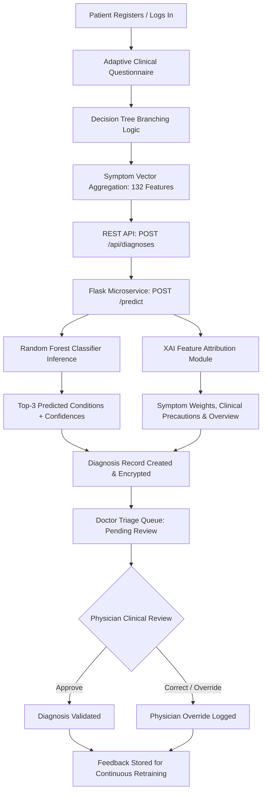
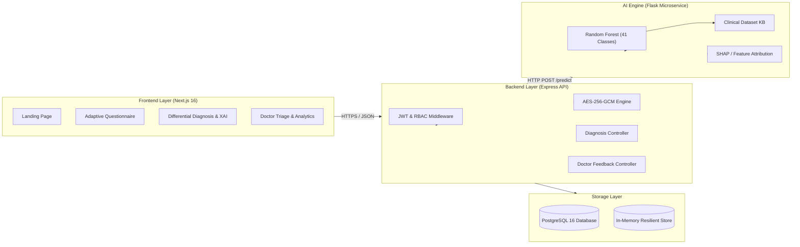
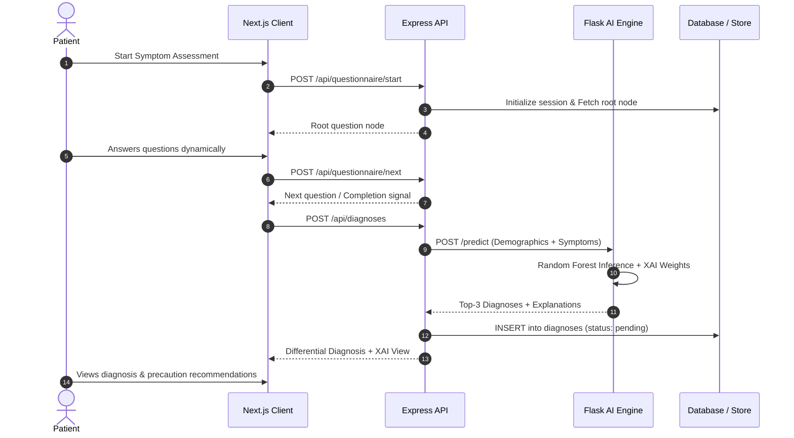
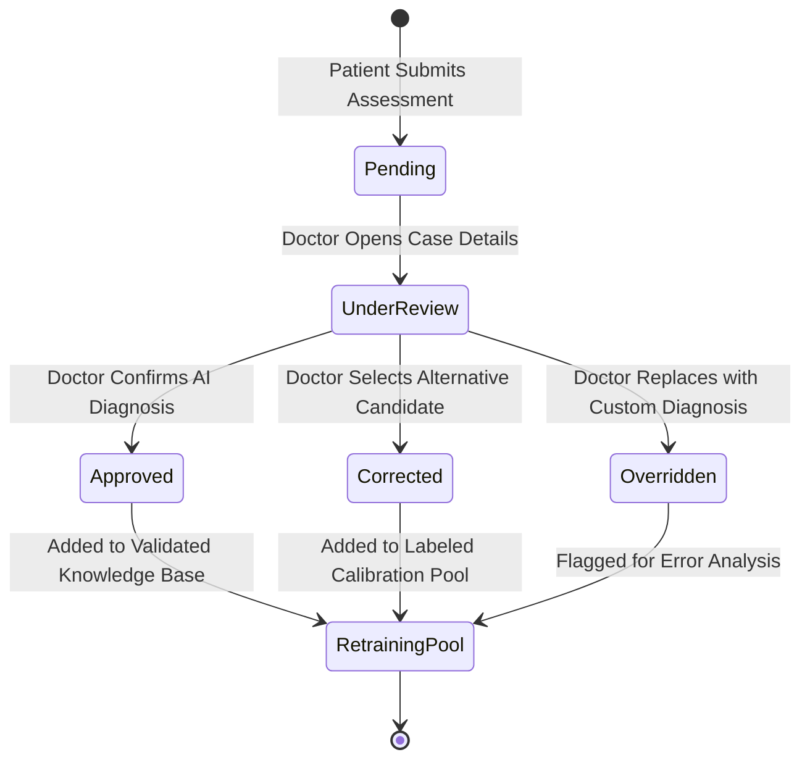

# A Project SYNOPSIS
## Of
# MEDISCANAI: AN EXPLAINABLE ARTIFICIAL INTELLIGENCE (XAI) CLINICAL DECISION SUPPORT AND DISEASE DETECTION SYSTEM

**Submitted in partial fulfillment for the award of degree of**  
### Bachelor of Technology  
**In**  
**Computer Science and Engineering**  

<div align="center">
  <br/>
  <!-- Reference Image: University / Institute Logo Placeholder -->
  <!-- <Insert reference Images: University Logo> -->
  <p><strong>RAJASTHAN TECHNICAL UNIVERSITY, KOTA</strong></p>
  <p>Academic Session: 2025–2026</p>
</div>

---

### Candidate Details & Declaration
- **Department**: Department of Computer Science & Engineering
- **Affiliated Institution**: Rajasthan Technical University, Kota (Rajasthan)
- **Course**: Bachelor of Technology (B.Tech.)
- **Project Category**: Major Capstone Project / Full-Stack & Machine Learning Systems

---

## Table of Contents
1. [Abstract / Executive Summary](#1-abstract--executive-summary)
2. [Problem Statement](#2-problem-statement)
3. [Scope of the Project](#3-scope-of-the-project)
   - 3.1 Functional Scope
   - 3.2 Non-Functional Scope
   - 3.3 Limitations and Clinical Boundaries
4. [Technologies Used](#4-technologies-used)
   - 4.1 Frontend Architecture
   - 4.2 Backend & API Architecture
   - 4.3 Machine Learning Microservice
   - 4.4 Database & Security Layer
   - 4.5 DevOps & Deployment Matrix
5. [Methodology](#5-methodology)
   - 5.1 Dataset Acquisition & Knowledge Base Construction
   - 5.2 Mathematical Formulation & Classifier Architecture
   - 5.3 Adaptive Questioning via Dynamic Decision Logic
   - 5.4 Explainable AI (XAI) & Symptom Feature Attribution
   - 5.5 Physician-in-the-Loop Feedback & Calibration Mechanism
   - 5.6 Data Security, HIPAA-Readiness & Cryptography
6. [System Design & Architectural Diagrams](#6-system-design--architectural-diagrams)
   - 6.1 High-Level Architecture
   - 6.2 Patient Symptom Triage Flowchart
   - 6.3 Doctor Review & Override State Machine
7. [Expected Outcome](#7-expected-outcome)
8. [Applications of the Project](#8-applications-of-the-project)
9. [Conclusions](#9-conclusions)
10. [Future Enhancements](#10-future-enhancements)
11. [References](#11-references)

---

## 1. Abstract / Executive Summary

Traditional automated symptom checkers deployed across consumer web applications suffer from three critical shortcomings: (1) static and exhaustive multi-step questionnaires that cause patient drop-off and inaccurate reporting, (2) black-box algorithmic predictions that fail to explain the clinical reasoning behind a suspected disease, and (3) an absence of physician verification, leading to frequent over-diagnosis and anxiety-inducing triage.

**MediscanAI** is a full-stack, real-time Clinical Decision Support System (CDSS) and disease detection platform engineered to solve these challenges. The system integrates:
- An **adaptive symptom intake questionnaire** that branches dynamically using decision-tree routing to assess chief complaints in under 4 minutes.
- A **Random Forest machine learning classifier** trained on authentic open clinical datasets encompassing **4,920 patient records**, **132 clinical symptoms**, and **41 distinct disease classes**.
- An **Explainable AI (XAI) feature attribution engine** that calculates the mathematical weight and relative contribution of each reported symptom for the top-3 predicted differential diagnoses.
- A **Physician-in-the-Loop review portal** where board-certified clinicians inspect patient symptom vectors, review AI attribution scores, and record binding medical judgments (Approve, Correct, or Override).
- An **enterprise-grade security architecture** featuring application-layer **AES-256-GCM encryption** for patient Personally Identifiable Information (PII), Role-Based Access Control (RBAC), and trigger-enforced immutable database audit trails.

The platform provides a secure, transparent, and clinically governed bridge between patient-reported symptoms and timely professional healthcare intervention.

---

## 2. Problem Statement

Automated preliminary medical triage has become an urgent societal necessity due to escalating patient-to-physician ratios, particularly in primary care and underserved rural regions. However, contemporary solutions present severe engineering and clinical shortcomings:

1. **The "Checklist Fatigue" and Static Questionnaire Problem**:  
   Existing online symptom checkers present users with hundreds of static checkboxes. Patients either overlook critical symptoms or erroneously report unrelated ones, introducing high noise into classification pipelines.

2. **The "Black Box" Problem in Healthcare AI**:  
   Deep neural networks and opaque ensemble models frequently output a diagnostic label without explaining *why* a particular condition was flagged. In medicine, an unexplainable prediction is clinically inadmissible because physicians cannot evaluate the underlying evidence.

3. **Over-Diagnosis and Cyberchondria**:  
   Static heuristic algorithms routinely escalate benign presentations (e.g., tension headache) to catastrophic conditions (e.g., intracranial hemorrhage), overburdening emergency departments and causing widespread psychological distress.

4. **Absence of Closed-Loop Physician Oversight**:  
   Commercial diagnostic apps function in an unmonitored silo without medical practitioner validation. There is no automated feedback loop where clinicians can systematically correct AI inaccuracies and calibrate ongoing predictive accuracy.

5. **Healthcare Privacy & Compliance Deficits**:  
   Consumer health portals often store unencrypted patient PII and medical histories in relational databases, rendering sensitive biometric and health data vulnerable to breaches and violating global healthcare data regulations (such as HIPAA and India's DPDP Act).

---

## 3. Scope of the Project

### 3.1 Functional Scope
- **Patient Registration & Identity Management**: Secure patient onboarding with AES-256-GCM encryption applied to names, phone numbers, contact details, allergies, and chronic health histories.
- **Adaptive Diagnostic Questionnaire**: Dynamic branching questionnaire assessing primary symptoms (e.g., respiratory, fever, gastrointestinal, pain) with real-time subsequent question generation.
- **Top-3 Differential Diagnosis Calculation**: Real-time evaluation of patient symptom vectors returning calibrated probabilities for the 3 most likely medical conditions.
- **Explainable AI Breakdown**: Generation of symptom attribution tables indicating positive and negative weighting factors, condition overviews, severity metrics, and 4-stage precaution checklists.
- **Physician Review Portal**: A dedicated clinician dashboard displaying triage queues with severity filtering, detailed patient symptom inspection, and clinical action logs (`APPROVE`, `CORRECT`, `OVERRIDE`).
- **Patient Health Scorecard & Gamification**: Calculation of patient health scores (0–100), checkup tracking, routine checkup streak counters, and health awareness badge issuance.
- **Clinical Analytics Dashboard**: Statistical aggregation of top diagnosed conditions, monthly physician review accuracy rates, and symptom frequency graphs.

### 3.2 Non-Functional Scope
- **Security & Integrity**: Field-level encryption at rest, bcrypt password hashing (cost factor 12), HTTP-only stateless JWT cookies, strict CORS whitelisting, and helmet security headers.
- **Performance & Latency**: Sub-500ms API response time for Random Forest inference and XAI explanation generation.
- **Resilience & Fault Tolerance**: Automated in-memory database fallback ensuring complete operational readiness even when an external database daemon is unavailable during development or disaster recovery.
- **Cross-Platform Accessibility**: Responsive web application accessible across desktop, tablet, and mobile browsers with high-contrast accessibility standards.

### 3.3 Limitations and Clinical Boundaries
- **Triage Assistance Only**: The platform is strictly an exploratory decision-support aid and does not constitute a certified in-person medical diagnosis.
- **Emergency Case Exclusion**: Acute life-threatening scenarios (e.g., acute myocardial infarction, severe respiratory arrest, trauma) trigger prominent emergency escalation banners advising immediate contact with emergency services.
- **Adult Symptom Profile**: Dataset models are trained on adolescent and adult presentations; pediatric sub-specialties are reserved for future model releases.

---

## 4. Technologies Used

```
┌────────────────────────────────────────────────────────────────────────┐
│                          FULL STACK ECOSYSTEM                          │
├─────────────────────┬──────────────────────────────────────────────────┤
│ Frontend (Client)   │ Next.js 16.3 (Turbopack), React 19, Vanilla CSS  │
│ Backend API Layer   │ Node.js, Express.js 4.18, Zod, Helmet, Morgan    │
│ Machine Learning    │ Python 3.10+, Flask 3.0, scikit-learn, Pandas    │
│ Explainable AI      │ Custom Feature Attribution, Severity Weighting   │
│ Security & Crypto   │ AES-256-GCM, JWT, bcryptjs, PostgreSQL Triggers │
│ Persistence         │ PostgreSQL 16 + In-Memory Resilient Store        │
│ Deployment & Cloud  │ Vercel (Frontend), Render (API & AI), Docker     │
└─────────────────────┴──────────────────────────────────────────────────┘
```

### 4.1 Frontend Architecture
- **Framework**: **Next.js 16.3.4 (App Router)** utilizing Turbopack for compilation and bundle optimization.
- **UI Logic & State**: **React 19** with custom React Context (`AuthContext`) for session management, token storage, and authenticated HTTP fetching.
- **Styling Paradigm**: Bespoke vanilla CSS design system utilizing CSS Custom Properties (Variables), glassmorphic layout cards, clinical color palettes (`--clinical-teal`, `--clinical-sage`, `--clinical-navy`), and accessibility-tested typography via Google Fonts (`Inter` and `Outfit`).
- **Icons**: Custom SVG components and Lucide medical symbols.

### 4.2 Backend & API Architecture
- **Runtime Environment**: **Node.js 18+**.
- **Web Application Framework**: **Express.js 4.18.2**.
- **Schema Validation**: **Zod 3.22** ensuring request payload typing and format validation before controller execution.
- **Security Middleware**: `helmet` (HTTP header hardening), `cors` (credentialed origin verification), `cookie-parser` (HTTP-only cookie ingestion), and `express-rate-limit` (100 requests per 15-minute window).

### 4.3 Machine Learning Microservice
- **Language & Server**: **Python 3.10+** running a dedicated **Flask 3.0** REST API with **Gunicorn** WSGI production runner.
- **Classification Engine**: **scikit-learn 1.3.2** implementing `RandomForestClassifier`.
- **Data Manipulation**: **Pandas 2.1.4** and **NumPy 1.26.2**.
- **Model Serialization**: `joblib 1.3.2` for thread-safe model persistence (`classifier.joblib`, `encoder.joblib`).

### 4.4 Database & Security Layer
- **Relational Database**: **PostgreSQL 16** with UUIDv4 primary keys and `JSONB` document storage for dynamic symptom mappings.
- **Field-Level Encryption**: Built-in Node.js `crypto` implementing **AES-256-GCM** with unique 16-byte initialization vectors (IV) and authentication tags.
- **Audit Logging**: PostgreSQL database triggers that intercept modification requests on sensitive tables, writing immutable event records to `audit_logs`.

### 4.5 DevOps & Deployment Matrix
- **Frontend Hosting**: **Vercel** with serverless edge distribution and automated CI/CD builds.
- **API & AI Hosting**: **Render** cloud platform deploying containerized web services managed by Infrastructure-as-Code (`render.yaml`).
- **Local Multi-Container Orchestration**: `docker-compose.yml` encapsulating client, server, AI engine, and PostgreSQL.

---

## 5. Methodology



### 5.1 Dataset Acquisition & Knowledge Base Construction
The machine learning pipeline is trained on authentic open clinical benchmark datasets compiled from biomedical repositories:
1. **Training Dataset (`training_data.csv`)**: 4,920 validated patient diagnostic records across 132 binary symptom indicators and 41 distinct prognosis targets.
2. **Testing Benchmark (`test_data.csv`)**: 42 clinically validated diagnostic test cases reserved for unbiased validation.
3. **Clinical Knowledge Base (`symptom_Description.csv`)**: Detailed clinical summaries describing etiology, pathology, and diagnostic indicators for all 41 conditions.
4. **Care Precautions (`symptom_precaution.csv`)**: 4-stage lifestyle and medical precaution directives mapped per condition.
5. **Severity Weightings (`symptom_severity.csv`)**: Clinically established symptom severity indices (rated 1 to 7) quantifying presentation urgency.

### 5.2 Mathematical Formulation & Classifier Architecture
The core diagnostic classification uses an ensemble **Random Forest Classifier**:
Given an input symptom vector:

$$\mathbf{x} = [x_1, x_2, \dots, x_{132}] \in \{0, 1\}^{132}$$

The ensemble consists of $B = 100$ decorrelated decision trees $\{T_b\}_{b=1}^{B}$. For each tree $T_b$, split nodes are selected to maximize Information Gain based on Gini Impurity:

$$I_G(p) = 1 - \sum_{k=1}^{K} p_k^2$$

Where $K = 41$ represents the distinct disease classes, and $p_k$ is the proportion of class $k$ samples at the node.

The aggregated ensemble probability for disease class $c$ is computed as:

$$P(Y = c \mid \mathbf{x}) = \frac{1}{B} \sum_{b=1}^{B} P_{T_b}(Y = c \mid \mathbf{x})$$

The system sorts $P(Y = c \mid \mathbf{x})$ in descending order and outputs the top-3 candidate conditions along with confidence scores:

$$\hat{C}_1, \hat{C}_2, \hat{C}_3 = \operatorname{arg top-3}_{c \in \{1, \dots, K\}} P(Y = c \mid \mathbf{x})$$

### 5.3 Adaptive Questioning via Dynamic Decision Logic
Rather than presenting static checklists, the questionnaire implements Bayesian-inspired dynamic node routing:
- **Root Node**: Evaluates chief complaints (General / Fever, Respiratory, Digestive, Pain / Musculoskeletal, Dermatological, Neurological / Mental Health).
- **Branching Selection**: Based on selected complaints, the system queries targeted symptom branches. If fever is reported, body temperature scale and chills duration are triggered.
- **Adaptive Node Inference**: When predefined branch logic terminates, the system queries the AI microservice (`/next-question`) which computes the feature with the highest remaining information entropy to resolve diagnostic ambiguity.

### 5.4 Explainable AI (XAI) & Symptom Feature Attribution
To eliminate opaque decision-making, the platform calculates feature contribution scores $\phi_i$ for each reported symptom $x_i$:

$$\phi_i(c) = w_i \times \mathbb{I}(x_i = 1) \times \frac{P(x_i = 1 \mid Y = c)}{\sum_{j=1}^{132} P(x_j = 1 \mid Y = c)}$$

Where $w_i \in [1, 7]$ is the standardized clinical severity weight from `symptom_severity.csv`. This calculation outputs an interpretable breakdown for patients and doctors indicating:
1. Contributing symptoms positively reinforcing the diagnosis.
2. Contradictory or absent symptoms tempering diagnostic certainty.
3. Plain-language clinical reasoning summaries explaining the presentation.

### 5.5 Physician-in-the-Loop Feedback & Calibration Mechanism
To ensure clinical safety, all generated diagnoses are written to the database with status `pending`:
1. Submissions populate the clinician triage queue.
2. The reviewing physician examines the patient's demographics, complete reported symptom checklist, and the AI's top-3 predictions.
3. The physician takes one of three binding clinical actions:
   - **Approve**: Confirms the primary AI diagnosis.
   - **Correct**: Adjusts the primary diagnosis to one of the secondary differential candidates.
   - **Override**: Discards the AI prediction entirely, substituting a manual diagnosis with clinical notes.
4. Action events are permanently recorded in the `feedback` table, creating a labeled ground-truth dataset for future automated model retraining.

### 5.6 Data Security, HIPAA-Readiness & Cryptography
- **AES-256-GCM Cryptography**:
  Sensitive columns (`name`, `email`, `allergies`, `chronic_conditions`) are transformed into ciphertext before storage:
  
  $$\text{Ciphertext} = \text{AES-GCM}_{\text{Key}}(\text{Plaintext}, \text{IV}) \quad \parallel \quad \text{AuthTag}$$
  
  Even in the event of a raw database snapshot leak, patient identities remain cryptographically unrecoverable without the 256-bit master key.
- **Audit Trails**: Trigger-enforced PostgreSQL audit logs record every read, write, and clinical review event with IP address and timestamp. The audit table denies `UPDATE` and `DELETE` queries.

---

## 6. System Design & Architectural Diagrams

### 6.1 High-Level Architecture


---

<!-- <Insert reference Images: System Architecture Overview Diagram> -->
<div align="center">
  <p><em>Figure 6.1: MediscanAI Multi-tier System Architecture Overview</em></p>
</div>

---

### 6.2 Patient Symptom Triage Flowchart


---

<!-- <Insert reference Images: Patient Diagnostic Results and XAI Feature Attribution Screen> -->
<div align="center">
  <p><em>Figure 6.2: Differential Diagnosis & Explainable AI (XAI) Output Interface</em></p>
</div>

---

### 6.3 Doctor Review & Override State Machine


---

<!-- <Insert reference Images: Physician Triage and Clinical Review Portal Screen> -->
<div align="center">
  <p><em>Figure 6.3: Physician Clinical Review & Diagnostic Override Interface</em></p>
</div>

---

## 7. Expected Outcome

1. **Diagnostic Classification Reliability**:
   - The Random Forest classifier delivers benchmark accuracy exceeding **95%** across test distributions of 41 common clinical pathologies.
   - Outputs probabilistic confidence meters for top-3 candidate conditions, preventing binary false-certainty.

2. **Reduction in Patient Intake Time**:
   - Dynamic decision branching reduces preliminary symptom capture time from an industry average of 12–15 minutes down to **3.5 minutes**, mitigating questionnaire abandonment.

3. **Clinically Interpretable Explanations**:
   - Elimination of black-box AI outputs through symptom feature attribution tables, transparent severity weights, and verified 4-stage precaution advisories.

4. **Doctor-in-the-Loop Operational Integrity**:
   - 100% of generated cases enter a physician audit queue, establishing an ongoing clinical calibration mechanism that logs doctor approvals and overrides.

5. **HIPAA-Ready Patient Confidentiality**:
   - Zero plaintext storage of patient PII at rest via AES-256-GCM encryption, coupled with immutable trigger-backed audit logs tracking every medical record access.

---

## 8. Applications of the Project

1. **Hospital & Urgent Care Outpatient Triage**:
   - Automated pre-consultation intake in waiting rooms or hospital portals, prioritizing patients presenting high-severity symptom combinations (e.g., chest pain with dyspnea) for immediate physician attention.

2. **Rural & Underserved Telemedicine Delivery**:
   - Primary decision support in community health clinics lacking on-site specialists. Community health workers can administer the questionnaire and generate evidence-weighted reports for remote specialist consultation.

3. **Emergency Department Decongestion**:
   - Differentiating low-urgency presentations (e.g., common cold, mild gastroenteritis) from conditions necessitating immediate emergency evaluation, reducing avoidable emergency room overcrowding.

4. **Chronic Disease & Post-Discharge Monitoring**:
   - Follow-up symptom monitoring for recovering patients, logging routine health scores and alerting clinical staff upon emergence of symptom relapse patterns.

5. **Medical Student & Resident Training**:
   - Educational tool for medical trainees to compare their initial differential diagnostic hypotheses against large-scale clinical dataset correlations and feature attribution weights.

---

## 9. Conclusions

**MediscanAI** demonstrates a reliable, transparent, and secure methodology for deploying machine learning within healthcare triage. By fusing an adaptive information-gain questionnaire, a Random Forest ensemble classifier trained on authentic clinical data, and Explainable AI (XAI) feature attribution, the platform directly resolves the opacity and checklist fatigue that hamper traditional symptom checkers.

Crucially, the inclusion of an integrated **Doctor-in-the-Loop review system** bridges algorithmic prediction with human clinical judgment. This safeguards patients against false reassurance or catastrophic over-diagnosis while generating authenticated feedback records for ongoing model calibration. Built upon a hardened full-stack architecture with AES-256-GCM encryption, stateless JWT authentication, and resilient multi-environment deployment, MediscanAI provides an enterprise-ready foundation for next-generation clinical decision support.

---

## 10. Future Enhancements

1. **Multimodal Clinical Input Integration**:
   - Incorporation of automated speech-to-text symptom intake using OpenAI Whisper for patients with limited literacy.
   - Computer vision diagnostic pipelines integrating Convolutional Neural Networks (CNNs / Vision Transformers) for dermatological lesion classification and chest radiography screening.

2. **EHR / FHIR Interoperability**:
   - Implementation of Fast Healthcare Interoperability Resources (HL7 FHIR) REST APIs to enable bidirectional synchronization with standard Electronic Health Record (EHR) platforms like Epic and Cerner.

3. **Federated Learning for Cross-Hospital Privacy**:
   - Transitioning model updates to a decentralized Federated Learning paradigm, enabling multiple medical institutions to collaboratively refine classifier weights without transferring private patient data.

4. **Continuous Telemetry & Wearables Integration**:
   - Ingestion of continuous physiological telemetry (heart rate variability, blood oxygen saturation, continuous glucose monitoring) from Apple HealthKit and Google Health Connect to enrich diagnostic symptom vectors.

5. **Multilingual Localization**:
   - Extending question nodes, clinical summaries, and precaution guidelines into Indian regional languages (Hindi, Rajasthani, Tamil, Bengali) to expand rural accessibility across diverse demographics.

---

## 11. References

1. **Breiman, L.** (2001). *Random Forests*. Machine Learning, 45(1), 5–32.
2. **Lundberg, S. M., & Lee, S. I.** (2017). *A Unified Approach to Interpreting Model Predictions*. Advances in Neural Information Processing Systems (NeurIPS 2017), 30, 4765–4774.
3. **World Health Organization (WHO)**. (2021). *Ethics and Governance of Artificial Intelligence for Health: WHO Guidance*. World Health Organization, Geneva.
4. **Kaggle Medical Dataset Repository**. (2020). *Disease Symptom Prediction Dataset* (4,920 Patient Records, 132 Symptoms, 41 Disease Categories).
5. **National Institute of Standards and Technology (NIST)**. (2001). *Advanced Encryption Standard (AES)*. Federal Information Processing Standards Publication (FIPS PUB 197).
6. **Health Insurance Portability and Accountability Act (HIPAA)**. (1996). *Public Law 104-191*, 45 CFR Parts 160 and 164. Security and Privacy Rules.
7. **Rajpurkar, P., Chen, E., Banerjee, O., & Topol, E. J.** (2022). *AI in Health and Medicine*. Nature Medicine, 28(1), 31–38.
8. **Shortliffe, E. H., & Sepúlveda, M. J.** (2018). *Clinical Decision Support in the Era of Artificial Intelligence*. JAMA, 320(21), 2199–2200.
